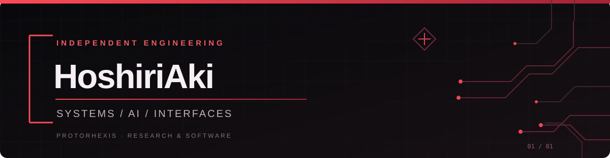

  

  
<strong>Independent Software Developer · Systems Engineering · Applied AI</strong>

  
Building dependable software today. Exploring human–AI collaboration for tomorrow.

  

    <a href="#english">English</a> ·
    <a href="#简体中文">简体中文</a> ·
    <a href="https://github.com/PROTORHEXIS">PROTORHEXIS</a> ·
    <a href="mailto:closure_aki@qq.com">Contact</a>
  

---

## Hello, I'm HoshiriAki.

I am an independent developer working across **software systems, web applications, automation, and applied AI**. My approach is to turn a problem into explicit requirements, implement a solution with clear boundaries, and verify that it behaves as intended.

I care about reliability, understandable architecture, data integrity, fault isolation, and evidence-based engineering. I also enjoy exploring new forms of human–computer interaction.

### What I can help build

| Area | Example scope |
| --- | --- |
| Web applications | Business dashboards, management interfaces, responsive tools |
| Automation & AI integration | Workflow automation, practical agent-assisted features, API integrations |
| Backend & data | APIs, PostgreSQL/SQLite-backed services, data workflows |
| Engineering improvements | Debugging, refactoring, test design, reproducible validation |

I welcome **well-scoped freelance projects and technical collaborations**. A good starting point is a short description of the problem, expected outcome, constraints, and timeline.

### Long-term engineering & research

- **[PROTORHEXIS / 源爆点](https://github.com/PROTORHEXIS)** — an emerging initiative exploring research, engineering, and sustainable human–AI collaboration.
- **TALOS** — ongoing R&D on modular software infrastructure, multi-tenant boundaries, auditable execution, and trustworthy operations. Core work is primarily private and still subject to validation.
- **MAXWELL** — exploratory work on agent execution and engineering workflows; a research direction, not a production-ready product.
- **Spatial interfaces** — experiments in semantic UI translation, navigable information spaces, and interaction beyond traditional flat panels.

These are **works in progress**. Research prototypes and validation results should not be mistaken for production availability.

### Public work

| Repository | What it shows |
| --- | --- |
| [custom-dev-configurator](https://github.com/HoshiriAki/custom-dev-configurator) | Public-facing requirements and estimate configurator; MVP with private authoritative pricing |
| [webm2gif](https://github.com/HoshiriAki/webm2gif) | A small WebM-to-GIF conversion utility |
| [TALOS-UI-API-CI-MIRROR](https://github.com/HoshiriAki/TALOS-UI-API-CI-MIRROR) | A deliberately limited public CI/API mirror; not the private product source |

**Tools I frequently work with:** `Rust` · `TypeScript` · `Vue 3` · `Python` · `PostgreSQL` · `SQLite` · `Linux` · `Git`

**Contact:** [closure_aki@qq.com](mailto:closure_aki@qq.com) · [GitHub profile](https://github.com/HoshiriAki)

---

## 你好，我是 HoshiriAki。

我是一名独立开发者，主要从事**软件系统、Web 应用、自动化与 AI 应用工程**。面对一个具体问题，我倾向于先理清需求、边界与验收条件，再进行实现和验证，让交付结果可以被理解、复现和维护。

我长期关注系统可靠性、可解释的架构、数据完整性、故障隔离和基于证据的工程实践，同时也热衷于探索新的信息组织与人机交互形式。

### 可承接的开发与协作

| 方向 | 典型范围 |
| --- | --- |
| Web 应用 | 业务后台、管理面板、响应式工具与可视化界面 |
| 自动化与 AI 集成 | 工作流自动化、实用型智能体功能、第三方 API 对接 |
| 后端与数据 | API、PostgreSQL/SQLite 数据服务、数据处理流程 |
| 工程质量改进 | 问题排查、代码重构、测试设计、可复现的验证流程 |

**接受范围清晰的项目制开发与技术合作。** 欢迎说明业务问题、预期结果、约束条件和时间要求；我会根据实际范围评估是否适合承接。

### 长期工程与研究

- **[PROTORHEXIS / 源爆点](https://github.com/PROTORHEXIS)**：正在发展的研究与工程计划，探索面向人机协作的技术基础设施和可持续组织形式。
- **TALOS**：围绕模块化基础设施、多租户边界、可审计执行与可信运行开展的研发工作。核心仓库以私有为主，相关设计和验证仍在推进。
- **MAXWELL**：智能体执行与工程工作流方面的探索性原型，目前属于研究方向，而非可直接交付的成熟产品。
- **空间交互**：研究语义驱动的 UI 翻译、空间化信息浏览，以及超越传统平面面板的交互模式。

以上方向均按**实际研发阶段**描述。实验原型、测试通过和生产可用是不同的事情，不会混为一谈。

### 公开项目

| 仓库 | 内容与边界 |
| --- | --- |
| [custom-dev-configurator](https://github.com/HoshiriAki/custom-dev-configurator) | 定制开发需求与预算估算前端；当前为 MVP，权威定价逻辑保留在私有侧 |
| [webm2gif](https://github.com/HoshiriAki/webm2gif) | WebM 转 GIF 的轻量工具 |
| [TALOS-UI-API-CI-MIRROR](https://github.com/HoshiriAki/TALOS-UI-API-CI-MIRROR) | 有边界的公开 CI/API 镜像，不代表私有产品源码或完整实现 |

**常用技术：** `Rust` · `TypeScript` · `Vue 3` · `Python` · `PostgreSQL` · `SQLite` · `Linux` · `Git`

**联系与合作：** [closure_aki@qq.com](mailto:closure_aki@qq.com) · [GitHub 主页](https://github.com/HoshiriAki)

---

  Build with clarity. Verify with evidence. Keep room for exploration.

